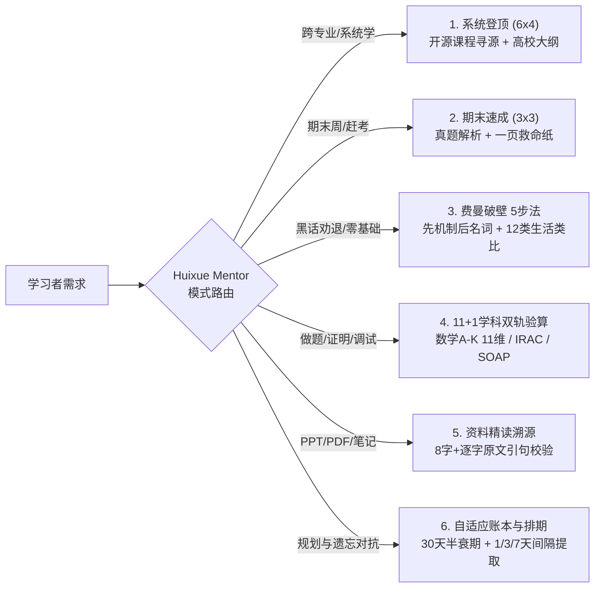

# 🎓 慧学导师 · Huixue Mentor

<p align="center">
  <strong>全学科大学生系统登顶 · 期末极限速成引擎 · 跨专业终生 AI 学习导师</strong><br>
  <em>All-Discipline University Mastery, Final-Exam Crash Engine, and Lifelong AI Learning Mentor</em>
</p>

<p align="center">
  <a href="./README_EN.md">English</a> · <a href="./SKILL.md">SKILL.md (Agent 协议)</a> · <a href="./references/discipline-rubrics.md">11+1 学科验算矩阵</a> · <a href="./examples/final-exam-cram-session.md">期末速成实战</a>
</p>

---

## 💡 创作初心（Why I Built This）

这个项目的起源非常朴素，来自大学校园里最真实的痛点：

> *“很多大学生平时忙于社团、竞赛或摸鱼，往往到了期末周才对着几百页 PPT 和往年真题临时抱佛脚；而当你毕业后或想跨专业去啃一门完全陌生的新领域（比如工科生想懂心理学、法学、金融学），面对满屏专业黑话又常常无从下手。”*

因此，「**慧学导师（Huixue Mentor）**」从 **「慧学」全栈 AI 学习平台** 的生产级核心引擎蒸馏而来，定位为一份**零外部依赖、跨 AI Agent 通用的开源技能包**：

1. **平时与跨专业**：做你**从 0 到巅峰的终生学习导师**（6 阶段 × 24 节高校培养体系 + 开源课程自动寻源）。
2. **期末周救急**：做你的**期末速成引擎**（3×3 核心骨架 + 真题原卷解析 + 原文逐字溯源闪卡 + 考前救命一页纸 + 倒计时动态排期）。
3. **硬核啃书做题**：自带 **11+1 全学科双轨独立验算** 与 **费曼零基础破壁 5 步法**，既让纯小白一看就懂，又绝不以牺牲严谨性为代价。

---

## ✨ 六大核心能力



- **🔍 权威课程寻源定锚（[`scripts/research-syllabus.mjs`](./scripts/research-syllabus.mjs)）**
  - 内置 **26 大学科规范检索族谱** 与 **12 门高校级 6 阶段×24 节点标准大纲**；
  - 联网自动检索 GitHub 高星开源课程并执行黑名单/相关性硬过滤，支持 **多 Token 池轮转** 与 **本地 ETag 304 零配额缓存**；无网自动降级到内置权威骨架。
- **🧮 11+1 全学科独立验算（[`references/discipline-rubrics.md`](./references/discipline-rubrics.md)）**
  - 涵盖：数学（7 步 + A–K 11 维验算）、计算机（复杂度 + 边界 Dry-Run）、物理工科（SI 量纲 + $0/\infty$ 极限）、生化环材（三大守恒 + $5'\to 3'$ 方向）、临床医学（SOAP + 红旗征 + 伦理免责）、经管财会（借贷平衡 + 折现匹配）、法学（IRAC + 请求权 + 禁编法条号）、建工设计（GB 550xx + WCAG≥4.5:1）、文史哲与外语写作。
- **🌱 费曼深入浅出破壁（[`references/feynman-and-density.md`](./references/feynman-and-density.md)）**
  - **先机制后名词** → **12 类跨域生活类比 + 诚实交代类比边界** → **黑话白话翻译表** → **直觉→原理→公式三阶梯** → **1 句反向小自检**。
- **📊 跨学科主动可视化（[`references/visual-and-exam-protocols.md`](./references/visual-and-exam-protocols.md)）**
  - 禁止超过 120 字的无断行文字墙；自动按文理不同形态嵌入 Mermaid 图解、Markdown 对比矩阵或结构化 `visual-spec` JSON。
- **📅 贝叶斯掌握度与动态考前排期（[`scripts/study-tracker.mjs`](./scripts/study-tracker.mjs)）**
  - 本地 JSON 持久化学习账本（`.huixue-study/study-ledger.json`），支持摸底定档、**30 天半衰期中性先验掌握度估计**、错题归档、闪卡自评隔离、带 `+1/+3/+7` 天间隔提取练习的考前倒计时排期，以及一键导出 Markdown《考前速记一页纸》。
- **🛡️ 反幻觉与学术诚实铁律**
  - 不伪造未执行的验算、不靠记忆乱编法条编号与页码、识图模糊先坦诚指明缺口、闪卡自评不冒充客观成绩、排期不宣称押题保过。

---

## 🚀 快速安装（支持主流 AI Agent）

本仓库遵循开放的 `Agent Skills` 标准规范（`SKILL.md` + `references/` + `scripts/`），**零 `npm install` 依赖**，仅需 Node.js 18+（推荐 Node 22+）。

### 方式 A：一键脚本安装

**Windows (PowerShell):**
```powershell
git clone https://github.com/<你的用户名>/huixue-mentor.git
cd huixue-mentor

# 安装到 Antigravity 全局技能库（跨所有项目自动生效）
powershell -ExecutionPolicy Bypass -File .\scripts\install.ps1 -Target antigravity-global

# 或同时安装到 Antigravity / Claude Code / Cursor / Codex
powershell -ExecutionPolicy Bypass -File .\scripts\install.ps1 -Target all
```

**macOS / Linux (Bash):**
```bash
git clone https://github.com/<你的用户名>/huixue-mentor.git
cd huixue-mentor
bash ./scripts/install.sh antigravity-global   # 或 claude / cursor / codex / all
```

### 方式 B：作为单项目技能直接集成
直接将本仓库复制到你的工作区 `.agents/skills/huixue-mentor/` 即可被 Antigravity 等兼容工具自动发现。

---

## 💻 CLI 独立运行速查（也可不经过 Agent 直接使用）

```bash
# 1. 查看内置 26 类检索学科与 12 门高校级大纲
node ./scripts/research-syllabus.mjs --list-disciplines

# 2. 为跨专业学科生成 6×4 系统路线（设置 GITHUB_TOKEN 可将检索上限提至 40 次/分钟）
node ./scripts/research-syllabus.mjs --major "心理学" --depth comprehensive

# 3. 期末速成：3×3 高频骨架（离线零网络也可用）
node ./scripts/research-syllabus.mjs --major "法学" --depth concise --offline

# 4. 初始化个人学习账本并试用示例课程
node ./scripts/study-tracker.mjs init --from-json ./examples/sample-course.json
node ./scripts/study-tracker.mjs diagnose --answers '[{"topicId":"t1","correct":false},{"topicId":"t3","correct":false}]'
node ./scripts/study-tracker.mjs practice --topic t1 --score 50 --total 4
node ./scripts/study-tracker.mjs plan --exam-date 2026-12-20 --daily-minutes 90
node ./scripts/study-tracker.mjs export-cheatsheet --out ./cheatsheet.md

# 5. 运行完整自检与端到端测试
node ./scripts/validate-skill.mjs
```

---

## 📂 仓库结构

```text
huixue-mentor/
├── SKILL.md                              # 核心技能协议与模式路由器
├── README.md / README_EN.md              # 中英文双语开源说明
├── LICENSE                               # MIT License
├── CONTRIBUTING.md                       # 学科验算与大纲贡献指南
├── references/                           # 渐进式披露参考手册
│   ├── discipline-rubrics.md             # 11+1 全学科解题与独立验算矩阵
│   ├── feynman-and-density.md            # 费曼 5 步法 + 12 类生活类比 + 三档认知密度
│   ├── visual-and-exam-protocols.md      # 图解协议 + 真题解析 + 8字原文溯源 + 变式出题
│   └── curated-syllabi-catalog.md        # 26 学科族谱 + 12 门 6×4 高校课程骨架
├── scripts/                              # 零依赖 Node.js 原生 CLI 工具与安装脚本
│   ├── research-syllabus.mjs             # 权威课程寻源与大纲定锚
│   ├── study-tracker.mjs                 # 诊断/掌握度/错题/闪卡/倒计时排期/速记单
│   ├── validate-skill.mjs                # 完整性、隐私扫描与端到端测试
│   ├── install.ps1 / install.sh          # Windows / Unix 多平台安装器
└── examples/                             # 实战样例与开箱试跑数据
    ├── sample-course.json
    ├── final-exam-cram-session.md
    └── cross-major-mastery-prompt.md
```

---

## 🤝 参与贡献 & 开源协议

欢迎大学生、教师与自学者一起补充更多冷门专业大纲与学科验算规则！详见 [CONTRIBUTING.md](./CONTRIBUTING.md)。
本项目采用 [MIT License](./LICENSE) 开源。
